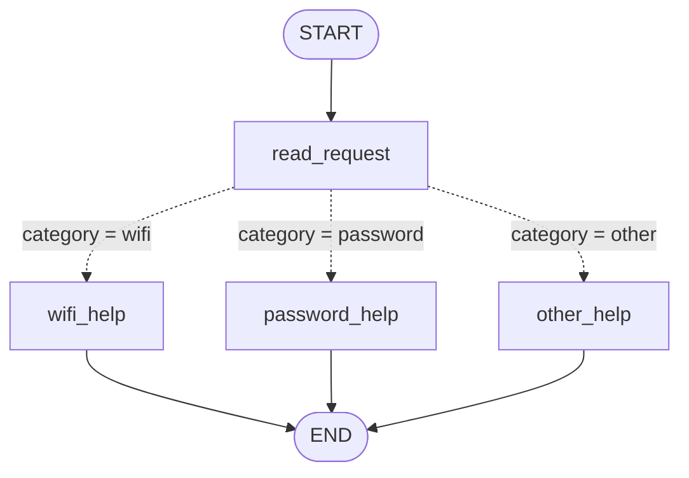
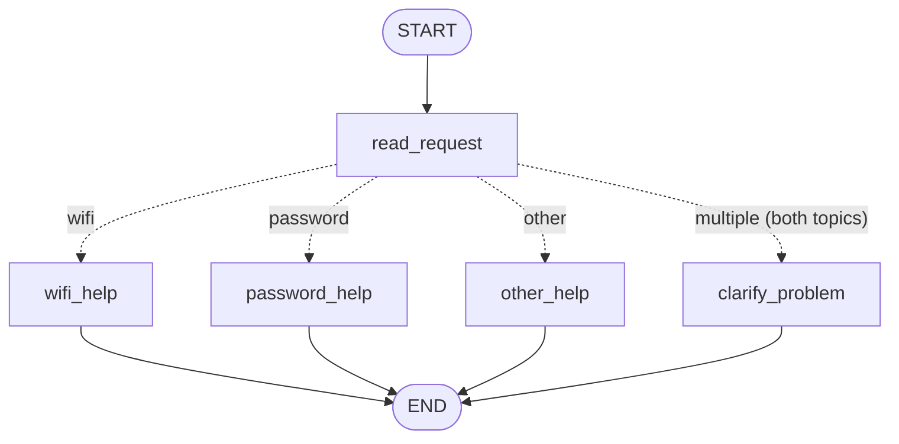
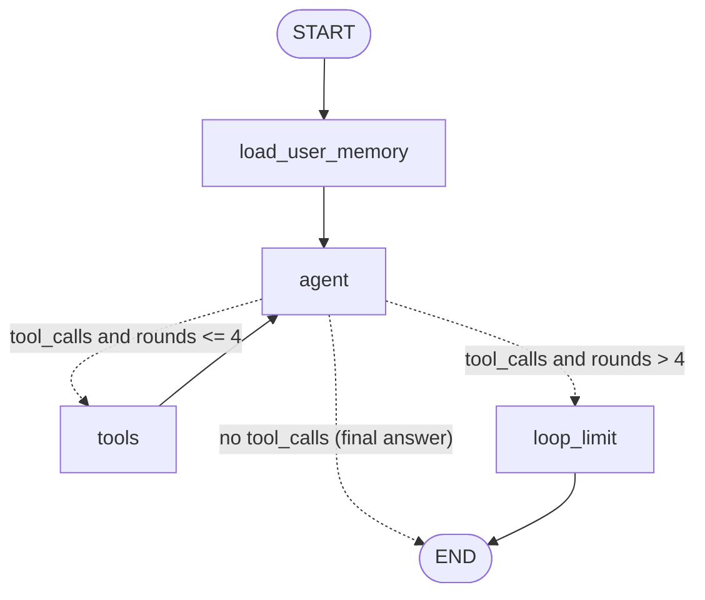

# HW5: My LangGraph helpdesk

Setup and exact commands are in [README.md](README.md). Model and provider: **Anthropic Claude
(`claude-opus-5-5`) through `langchain-anthropic` 1.7.10**, with LangGraph 1.2.20 on Python 3.13.15.

> **Logs.**
>
> - `outputs/part1/`: Part 1, no model.
> - `outputs/claude/`: the **real Claude run** (`claude-opus-5-5`) of S06–S14 and D01, made with
>   `python -m helpdesk scenarios --model anthropic` on 10 Nov 2026. All results below come from it.
> - `outputs/fake-model/`: the earlier offline dry run with the scripted fake model that the tests
>   use. It is kept only to show what CI exercises; it is not Claude's behaviour.

## Part 1 — How the graph works

### My graph and state

State (`HelpdeskState` in [helpdesk/part1.py](helpdesk/part1.py)):

| Field | Set by | Meaning |
| --- | --- | --- |
| `message` | the caller (input) | The user's original message. No node changes it. |
| `topics` | `read_request` | Every supported topic found, e.g. `["wifi", "password"]` (my extra field, kept for the trace) |
| `category` | `read_request` | `wifi`, `password` or `other` (and `multiple` in the changed graph) |
| `reply` | one help node | The answer |

What each node reads and changes:

| Node | Reads | Changes |
| --- | --- | --- |
| `read_request` | `message` | `topics`, `category` |
| conditional edge `route_by_category` | `category` | nothing; it only returns the next node's name |
| `wifi_help` | (instructions from `data/helpdesk.json`) | `reply` = GUIDE-WIFI steps |
| `password_help` | (instructions from `data/helpdesk.json`) | `reply` = GUIDE-PASSWORD steps |
| `other_help` | — | `reply` = "Does your problem concern Wi-Fi or a password?" |

The routing rules match `topic_aliases` in `helpdesk.json`, ignoring case:
`wifi`/`wi-fi` is checked first, then `password`, otherwise `other`.

**1. What does each node read and change?** See the table above. `read_request` is the only node
that interprets the message. The help nodes only produce a reply.

**2. Node update vs conditional edge.** A node is a function that returns a *partial update*, for
example `{"category": "wifi"}`. LangGraph merges that update into the state. A conditional edge is a
function that reads the state and returns *the name of the next node*. It changes nothing.
`read_request` decides *what the message is about*. `route_by_category` decides *where to go*.

**3. Does the next node receive only the previous update?** No. It receives the full current state
after the merge. In `outputs/part1/S01.json`, the state that `wifi_help` sees already contains
`message`, `topics` and `category`, even though `read_request` returned only `topics` and `category`.

**4. START, END, compile.** `START` and `END` are LangGraph's virtual entry and exit points: they
are not my functions. `START → read_request` says where execution begins. Reaching `END` finishes the
run and returns the final state. `compile()` checks the structure (nodes exist, edges point to real
nodes) and turns the builder into a runnable object with `invoke` and `stream`. The program cannot
run before it is compiled.

### Predictions before running

Command: `python -m helpdesk scenarios --model fake` (Part 1 needs no model; the same logs are
written with `--model anthropic`). One trace per message: `outputs/part1/S01.json` … `S04.json`.

| Message | Predicted route | Actual route | What I learned |
| --- | --- | --- | --- |
| I cannot connect to Wi-Fi. | read_request → wifi_help | START → read_request → wifi_help → END | `category` is set by `read_request`; `reply` appears only after `wifi_help` |
| I forgot my PASSWORD. | read_request → password_help | START → read_request → password_help → END | Lowercasing the message first makes the rule case-insensitive |
| My laptop screen is broken. | read_request → other_help | START → read_request → other_help → END | Unsupported requests get a question, not invented help |
| My Wi-Fi password does not work. | read_request → wifi_help | START → read_request → wifi_help → END | `topics` = `["wifi","password"]`, but the **order of the rules** (Wi-Fi checked first) sets `category = wifi`. The password half is silently ignored. |

**Both topics in one message.** In S04 (`outputs/part1/S04.json`), `read_request` finds both topics.
Rule 1 ("if it contains wifi/wi-fi → wifi") runs first, so the message goes to `wifi_help`. The
`password` rule is never reached, and the user gets Wi-Fi steps for a problem that may be a password
problem.

### My change to the graph

`build_part1_graph("with_clarification")` adds a `clarify_problem` node and a fourth branch. In this
variant, `read_request` sets `category = "multiple"` when it finds more than one topic. S05 trace
(`outputs/part1/S05.json`):

| Step | Update | State after |
| --- | --- | --- |
| read_request | `topics=["wifi","password"]`, `category="multiple"` | message, topics, category |
| clarify_problem | `reply="… Is the problem connecting to Wi-Fi, or recovering your account password? Which one should we solve first?"` | + reply |

Route: `START → read_request → clarify_problem → END`. The difference is a different *path* through
the graph, not just a different sentence from the same node.

**What LangGraph controls vs what my functions decide.** LangGraph controls the execution order:
it starts at `START`, calls each node, merges updates into the state, calls the edge function, runs
the node it names, and stops at `END`. My Python functions decide everything about meaning: which
words count as a topic, which rule wins, and what each reply says. No model makes any decision in
Part 1, so the same message always takes the same route.

## Part 2 — Model and tools

### The loop

1. The `agent` node sends the frozen system prompt plus the conversation to Claude.
2. Claude answers with either text, or `tool_use` blocks (`AIMessage.tool_calls`).
3. If tools were requested, the `tools` node (LangGraph `ToolNode`) runs my Python functions and
   appends one `ToolMessage` per call.
4. Control returns to `agent`, and Claude sees the results. It then requests more tools or answers.

| Tool | Source | Notes |
| --- | --- | --- |
| `find_instructions(topic)` | `data/helpdesk.json` | Returns steps plus `instruction_id`. Unknown topic → `found: false`, nothing invented |
| `check_service_status(service)` | selected snapshot in `data/service_status.json` | `password` → `account_recovery`. `unknown` is never treated as operational. `repair_time` is always null |
| `prepare_ticket(category, summary, steps_tried, service_status, reference_ids)` | `data/ticket_template.json` | Writes `outputs/tickets/TCK-….json` with status `draft`. Refuses a missing description or missing steps, and refuses text that looks like a password |
| `save_user_preference(language)` | user memory (Part 3) | Not a helpdesk tool; used for user memory |

Each tool has a plain function that works without the agent (`python -m helpdesk tool …`;
log: [outputs/direct-tool-calls.json](outputs/direct-tool-calls.json)). The LangChain versions are
built per session by `make_tools(ctx)`. The application sets `user_id`, `thread_id` and the status
snapshot in `ctx`, and they are **not** tool arguments, so the model cannot choose another user's
data or a different snapshot.

**1. How does the graph decide between running a tool and ending?** The conditional edge
`route_after_agent` reads the last message. No `tool_calls` means the model gave its final answer,
so the graph goes to `END`. If there are `tool_calls` and `tool_rounds` is within the limit, it goes
to `tools`. Above the limit, it goes to `loop_limit`.

**2. Who requests a tool, and who executes it?** Claude only *requests* a tool: it returns a
`tool_use` block with a name and JSON arguments. My program executes it: LangGraph's `ToolNode`
calls the Python function and wraps the result in a `ToolMessage`. The model never touches the files.

**3. What changes in the state after a tool result returns?** The `add_messages` reducer appends a
`ToolMessage` (tool name, `tool_call_id`, JSON result) to `messages`. Before that, the `agent` node
increased `tool_rounds` by one. On the next request Claude sees the result, so it can make the next
decision, for example "operational → call prepare_ticket" or "outage → do not". `prepare_ticket`
also writes a file outside the state.

**4. How is this different from Part 1?** In Part 1 the route is a fixed Python rule on keywords,
always the same for the same message. Here the graph only offers the options (tools or end). The
*model* chooses based on the meaning of the message and on tool results it has not seen before. The
same request can take a different number of loops, and stop at a different place, depending on the
status snapshot (S06/S07/S08).

**Loop limit.** `DEFAULT_MAX_TOOL_ROUNDS = 4` in [helpdesk/agent.py](helpdesk/agent.py), enforced
in `route_after_agent`:

- The counter `tool_rounds` is reset to 0 in `load_user_memory` at the start of each turn, and
  increased in `agent` each time the model asks for tools.
- On the 5th request the graph goes to `loop_limit` instead of `tools`. That node answers every
  pending tool call with "not executed" (so the saved history stays valid for Claude) and adds a
  final message. The log then shows `loop_limit_reached: true`.
- LangGraph's `recursion_limit` (`4·limit + 10` steps) is a second safety net.
- `test_loop_limit_stops_a_model_that_never_answers` uses a broken model that always asks for a tool.

**Multi-tool run: S06** ([outputs/claude/S06.json](outputs/claude/S06.json), model `claude-opus-5-5`)

| Turn | Model requests → tool results | Route |
| --- | --- | --- |
| 1. "Show me the Wi-Fi troubleshooting steps." | `find_instructions({"topic":"wifi"})` → GUIDE-WIFI, 4 steps | load_user_memory → agent → tools → agent → END |
| 2. "I enabled Wi-Fi and forgot the saved network … If it is operating, prepare a ticket …" | `check_service_status({"service":"wifi"})` → `operational`; *then* `prepare_ticket({"category":"wifi", "summary":"Campus-Demo Wi-Fi network will not connect.", "steps_tried":["Enabled Wi-Fi","Forgot the saved network"], "service_status":"operational", "reference_ids":["GUIDE-WIFI"]})` → created | load_user_memory → agent → tools → agent → tools → agent → END |

Final answer, turn 2 (shortened): *"Wi-Fi isn't down … Because the service is working, I made the
ticket you asked for. It's only a draft saved on this device, and nothing was sent.
File: `outputs/claude/tickets/TCK-20261109-200917-35DE16.json`"*. Claude made two separate model
requests: it asked for `prepare_ticket` only *after* it had seen the `operational` result. The
ticket contains only the two steps the user stated, and Claude took `GUIDE-WIFI` from the first turn
(conversation memory). The loop limit was not reached.

**Same request, different snapshot** (S06 second message = S07 message; S08 is a shorter variant):

| Snapshot | Scenario | Tool calls | What Claude did |
| --- | --- | --- | --- |
| `normal` (operational) | [S06](outputs/claude/S06.json) | check_service_status → prepare_ticket | Ticket draft created; "nothing was sent"; file name given |
| `wifi_outage` | [S07](outputs/claude/S07.json) | check_service_status only | "The Wi-Fi service is down … no repair time is available. You asked for a ticket only if Wi-Fi was working, so I didn't prepare one." No file created |
| `status_unavailable` | [S08](outputs/claude/S08.json) | check_service_status only | "The status check came back unknown … That doesn't mean Wi-Fi is working, and it doesn't confirm an outage either … Do you want me to prepare a local ticket draft anyway? It would say that the status couldn't be checked …" |

The graph and the prompt are identical in all three runs. Only the tool result changes, and with it
Claude's next step: one more tool call, or a final answer.

## Part 3 — Memory

**Conversation memory** is the LangGraph checkpointer `SqliteSaver` (`local-storage/conversations.sqlite`).
After every node, LangGraph saves the whole `AgentState`: all messages, the tool calls and results,
and the counters. When a session starts with the same `thread_id`, `graph.get_state()` and the next
`stream()` continue from the last checkpoint. That is how "that" in "I already tried that" can be
resolved, and how the conversation survives a restart.

**User memory** is a LangGraph `SqliteStore` (`local-storage/user_memory.sqlite`), with namespace
`("user_memory", <user_id>)` and key `preferences`, for example `{"language": "Kazakh"}`.

- **Writing:** only through the `save_user_preference` tool, which Claude calls when the user asks to
  remember a language. It is bound to the session's `user_id`.
- **Reading:** the `load_user_memory` node at the start of every turn, for the application's
  `user_id`. The value is appended to the history as a `USER_MEMORY: {...}` system message right after
  the user's message. It is not put into the top-level system prompt: Claude ties its thinking to the
  exact request prefix, so the system prompt stays frozen for the whole conversation
  (`test_anthropic_payload.py` checks this). Nothing is loaded from `demo_users.json`.

**`thread_id` vs user id.** `thread_id` identifies *one conversation*: its messages and its current
problem. `user_id` identifies *the person*, who can have many conversations. Preferences belong to the
person, so they are shared across that user's threads. Messages belong to the thread. The checkpoint
key is `"<user_id>::<thread_id>"`, so two users who type the same thread name still get separate
conversations (tested). The application sets both ids from the command line; the model never chooses them.

**Retrieval vs memory.** Looking up Wi-Fi steps is *retrieval*: `find_instructions` reads a fixed
reference document (`data/helpdesk.json`) that is the same for every user and that the conversation
never changes. Recalling "reply in Kazakh" is *memory*: the user told us, we wrote it down during a
conversation, and it is specific to that user. It would not exist if the user had not said it.

| Situation | Command used | Log file | What happened |
| --- | --- | --- | --- |
| Refer to an earlier message | `python -m helpdesk scenarios --model anthropic --only D01` (same as `chat --user demo-user-a --thread refer-a -m "I cannot connect to Wi-Fi." -m "I already tried that."`) | [outputs/claude/D01.json](outputs/claude/D01.json) | **Conversation memory:** turn 2 loaded 6 messages from the checkpoint. Claude read "that" as the GUIDE-WIFI steps it had just listed. Its previous answer had offered a ticket ("tell me which steps you've already tried"), so it drafted one with those steps, and said: "If you didn't actually do all three steps, tell me which ones and I'll make a corrected draft." **Reference file:** GUIDE-WIFI from turn 1 |
| Close, restart and resume | `python -m helpdesk scenarios --model anthropic --only S11` | [outputs/claude/S11.json](outputs/claude/S11.json) | Process 25544 saved the preference and answered. The program exited, and **process 13824** opened the same storage and thread. **Conversation memory:** 6 messages loaded. **User memory:** `{"language":"Kazakh"}`. Answer, in Kazakh: "Біз Wi-Fi мәселесін талқыладық. Сіз Wi-Fi-ды қосып, қайта қосылып көрдіңіз…" (we discussed Wi-Fi; you enabled it and tried reconnecting) |
| Same user, new conversation | `python -m helpdesk scenarios --model anthropic --only S12` | [outputs/claude/S12.json](outputs/claude/S12.json) | New process and new thread `preference-a2`. **Conversation memory:** 0 messages, so no replay. **User memory:** `{"language":"Kazakh"}`. Answer: "Сіз маған қазақ тілінде жауап беруді сұрадыңыз…" (you asked me to reply in Kazakh), then the scope list, all in Kazakh |
| Different user | `python -m helpdesk scenarios --model anthropic --only S13` | [outputs/claude/S13.json](outputs/claude/S13.json) | demo-user-a saved Kazakh. **demo-user-b:** user memory `{}`, 0 messages. Answer (English): "No, you haven't told me a preferred language, and you haven't mentioned a previous problem. Your saved preferences are empty…" |

Each log has a `sources` block: `reference_file` (helpdesk.json ids), `service_status`,
`user_memory_read`, `user_memory_written`. It also has `conversation_memory_read` (how many messages
came from the checkpoint, and the earlier user messages).

## Part 4 — Running and checking my work

- Setup, Python version, key configuration, run commands and memory reset: [README.md](README.md).
- Package versions: [requirements.txt](requirements.txt), pinned.
- CI: [.github/workflows/tests.yml](.github/workflows/tests.yml) installs `requirements.txt` on
  Python 3.13 and runs `python -m pytest -v` on every push and pull request, with an empty
  `ANTHROPIC_API_KEY`.
- All model-dependent tests use `FakeHelpdeskModel` ([helpdesk/fake_model.py](helpdesk/fake_model.py)),
  a clearly labelled rule-based stand-in, or `AlwaysWantsATool`. No test calls Claude. The real Claude
  demonstration is a separate manual command (`python -m helpdesk scenarios --model anthropic`).

| Test file | Checks | It would catch… |
| --- | --- | --- |
| `test_part1_routing.py` | 4 brief messages + aliases route correctly; replies come from the fixture; clarify variant | A changed rule order, a broken case-insensitive match, a help node returning invented text, `clarify_problem` leaking into the original graph |
| `test_tools.py` | Each tool called directly; every snapshot; ticket file shape; missing details; secrets; tool args | Reading the wrong snapshot, treating `unknown` as operational, a ticket missing template fields, a ticket created without steps, the model being able to pass `user_id` |
| `test_agent_loop.py` | Tool results return to the model; S06/S07/S08 differ; S09 asks first; loop limit | An edge that never returns from `tools`, a ticket made during an outage, a loop that never ends, unanswered tool calls left in history |
| `test_memory.py` | Same thread recall, reopen storage, preference across threads, user isolation, reset, **real process restart** | In-memory instead of SQLite storage, a thread key without the user, preferences leaking to demo-user-b, reset not deleting data |
| `test_cli.py` | Scenario runner does a real restart (different PIDs); real model needs a key | The runner faking a restart in one process; CI accidentally needing a key |
| `test_anthropic_payload.py` | Builds the actual Claude request offline | `temperature` being sent, the system prompt changing between turns, rewritten history (both break Claude requests) |

## Choices and limitations

- **Storage: SQLite for both memories** (`langgraph-checkpoint-sqlite`). The files survive restarts
  and need no server. `SqliteSaver` is LangGraph's own checkpointer, and `SqliteStore` is its own
  long-term store, so both memories use the documented persistence APIs. There are two files so that
  "reset conversation" and "reset preferences" stay separable.
- **Session context in closures, not tool arguments.** User, thread and snapshot are fixed by the
  application, as the data README requires.
- **Claude settings.** No `temperature`: current Claude models reject sampling parameters.
  `max_tokens=16000`, `effort=medium`, and the server-side refusal fallback is enabled for Opus and
  Sonnet (`HELPDESK_REFUSAL_FALLBACK=0` turns it off). Claude's thinking blocks are kept unchanged in
  the history, which is append-only.
- **Limitations:**
  - Whether a preference is saved depends on Claude calling `save_user_preference`. The ticket
    summary is written by Claude; the tool only checks that it is not empty.
  - The secret filter is a simple regex.
  - Only one preference (language) is stored.
  - The loop limit counts model *rounds*, not individual parallel tool calls.
  - The fake model only understands the scenario phrasings. It cannot translate into Kazakh; it only
    marks where Claude would reply in Kazakh.
  - Every turn appends one `USER_MEMORY` system message, so long threads repeat it.
- **Observed in the Claude run:**
  - In D01, Claude turned the vague "I already tried that" into a ticket listing all three guide
    steps. It said so openly and offered a correction, but it is still an assumption. **What I would
    change:** a stricter rule that the model must ask which steps were tried before drafting a ticket
    from a vague reference.
  - In S11, the first reply listed all four guide steps as "steps you have not done yet", including
    the reconnect step the user had already tried. This is a small wording slip. The resumed
    conversation after the restart recalled the steps correctly.
  - Claude kept the guide steps in English quotes inside Kazakh replies, because it quotes the tool
    result word for word as the system prompt asks.

## Supplied scenarios — my actual results

Everything was run with `python -m helpdesk scenarios --model anthropic` (model `claude-opus-5-5`).
To run one scenario, add `--only S07`. The one-line overview is in
[outputs/claude/SUMMARY.md](outputs/claude/SUMMARY.md). No scenario reached the loop limit.

| Scenario | Command or manual steps | Log file | What happened / what I changed |
| --- | --- | --- | --- |
| S01 — Simple Wi-Fi route | `python -m helpdesk scenarios --only S01` | `outputs/part1/S01.json` | read_request → wifi_help; GUIDE-WIFI steps. As predicted |
| S02 — Case-insensitive password route | `… --only S02` | `outputs/part1/S02.json` | read_request → password_help. Lowercasing makes `PASSWORD` match |
| S03 — Unsupported request | `… --only S03` | `outputs/part1/S03.json` | read_request → other_help; asks "Wi-Fi or a password?" |
| S04 — Two topics before the graph change | `… --only S04` (original graph) | `outputs/part1/S04.json` | topics = wifi+password, but category = wifi (rule order) → wifi_help. This is the problem the change fixes |
| S05 — Two topics after adding clarification | `… --only S05` (`with_clarification`) | `outputs/part1/S05.json` | category = multiple → clarify_problem asks which problem comes first |
| S06 — Instructions then local ticket | `… --model anthropic --only S06` | [outputs/claude/S06.json](outputs/claude/S06.json) | Turn 1: find_instructions → GUIDE-WIFI. Turn 2: check_service_status → operational, then prepare_ticket with only the user's two steps and GUIDE-WIFI → `outputs/claude/tickets/TCK-20261109-200917-35DE16.json`, "nothing was sent" |
| S07 — The same request during a Wi-Fi outage | `… --only S07` | [outputs/claude/S07.json](outputs/claude/S07.json) | check_service_status → outage. No ticket, "no repair time is available", and Claude explained it followed the condition |
| S08 — Status source unavailable | `… --only S08` | [outputs/claude/S08.json](outputs/claude/S08.json) | check_service_status → unknown. "Doesn't mean Wi-Fi is working … doesn't confirm an outage". No ticket; asked whether to draft one that says the status couldn't be checked |
| S09 — Missing ticket details | `… --only S09` | [outputs/claude/S09.json](outputs/claude/S09.json) | Turn 1: no tool call, asked for the problem and steps tried (and warned not to include passwords). Turn 2: prepare_ticket with `service_status: not_checked` and steps "Enabled Wi-Fi", "Tried reconnecting" |
| S10 — Use the current conversation | `… --only S10` | [outputs/claude/S10.json](outputs/claude/S10.json) | Turn 2 loaded 6 messages from the checkpoint, no tools, and answered with exactly the user's steps: turned on Wi-Fi, forgot the network and reconnected |
| S11 — Persist and recall after restart | `… --only S11` (new process at `restart_process`) | [outputs/claude/S11.json](outputs/claude/S11.json) | PID 25544 → 13824. Saved Kazakh via save_user_preference. After the restart, 6 messages + user memory loaded; recalled the Wi-Fi problem and steps, in Kazakh |
| S12 — Preference across threads without replay | `… --only S12` | [outputs/claude/S12.json](outputs/claude/S12.json) | PID 23604 → 13940, new thread: 0 messages, user memory `{"language":"Kazakh"}`; answered in Kazakh that Kazakh was requested, plus the scope |
| S13 — Do not share memory between users | `… --only S13` | [outputs/claude/S13.json](outputs/claude/S13.json) | demo-user-b: empty user memory, 0 messages; "you haven't told me a preferred language … or a previous problem", in English |
| S14 — Password recovery outage | `… --only S14` | [outputs/claude/S14.json](outputs/claude/S14.json) | check_service_status(account_recovery) → outage; "status data doesn't say when it will be fixed"; offered a ticket draft without inventing details |
